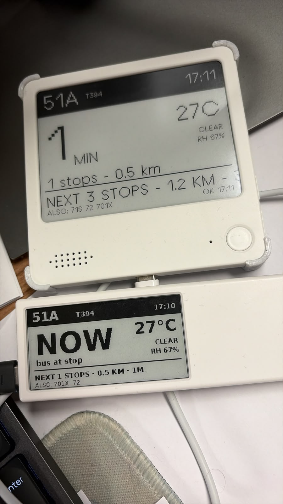

# NOTE4 Bus Display (note4-bus)

Quote/0-style live bus arrival card for a **configurable DSAT stop + route** on
a ZECTRIX NOTE4 4.2" 400x300 black-and-white e-paper dev board (ESP32-S3 N16R8).

The device connects to Wi-Fi, fetches live bus positions from the DSAT API
(bis.dsat.gov.mo) plus Cotai weather from Open-Meteo every **5 minutes**, and
repaints the e-paper screen.



*The NOTE4 (top) and the Quote/0 (bottom) side by side — same stop, same data,
matching layout. Photo taken minutes apart (17:10 vs 17:11).*

## Screen layout (mirrors the Quote/0 image output)

- Black header bar: hero route (large), stop code, clock (SNTP, UTC+8)
- Hero ETA in minutes (very large), unit MIN; sub-line "N stops - X km"
- Weather block top-right: temperature, condition, RH (Open-Meteo, Cotai)
- Divider, then footer: "NEXT n STOPS - X KM - nM" (following bus) and
  "ALSO: <other routes at the stop>" (from the embedded stop database)
- If the configured route does not serve the stop, the firmware probes the
  stop's other routes and displays the first live one.

## Configure (over USB serial)

```
bus-set stop T394        # any DSAT stop code (all 451 stops embedded)
bus-set route 51A        # hero route for the header/hero ETA
bus-set ssid <ssid>      # multi-word SSIDs: quote them
bus-set pass <password>
bus-save
bus-reboot
```

Other console commands: `bus-show`, `bus-now` (refresh immediately),
`bus-reboot`. Everything is stored in NVS. Current setup: **T394
(新城大馬路／威尼斯人), route 51A**.

## Build

Requires ESP-IDF 6.1 (installed at `~/.espressif/frameworks/espressif-idf-v6.1.0`).
NOTE: the system python3 is 3.14; IDF's venv is pinned to 3.12 — always
source `idf-env.sh` (it exports `IDF_PYTHON_ENV_PATH` for you).

```bash
source idf-env.sh
idf.py -p /dev/ttyACM0 build flash monitor
```

`main/bus_stops_data.h` is generated from the macau-bus repo's
`data/stops.json` (all 451 DSAT stops with coordinates + route lists).

## Behavior

- Boot: splash -> Wi-Fi connect -> SNTP (CST-8, ntp.aliyun.com first) -> first
  fetch+paint.
- Update cycle: 2 HTTPS GETs to DSAT (hero route, both directions) + 1 to
  Open-Meteo, cJSON parse, direction chosen where the stop appears earliest
  (same rule as the macau-bus host pipeline), nearest + next bus counted per
  bus (not per station). ETA = straight-line km / flat 25 km/h — identical
  math to the Quote/0 display, so both devices agree at the same instant.
- Wi-Fi down: retries every 30 s, screen keeps last data with status footer.
- Wi-Fi config missing: shows on-screen instructions and waits for NVS save.

## Layout / project map

- `main/bus_main.cc`      — app flow, Quote/0-style card rendering, update loop
- `main/bus_api.cc/.h`    — DSAT HTTP + cJSON parsing, ETA math, weather
- `main/bus_config.cc/.h` — NVS config (ssid/pass/stop/route) + console commands
- `main/bus_wifi.cc/.h`   — Wi-Fi STA bring-up
- `main/bus_stops_data.h` — generated stop database: all 451 DSAT stops (do not edit by hand)
- `components/zectrix_epd`— SSD2683 e-paper driver (ZECTRIX, MIT)
- `components/hearth_gfx` — 400x300 1bpp canvas + ASCII font (from Hearth)
- `partitions.csv`, `sdkconfig.defaults` — 16MB flash, octal PSRAM, USB console

## Firmware backup

Original factory firmware backed up before first flash:
`../../firmware-backup/firmware_backup_16MB.bin` (SHA256
`05c6fee12192b14cfc2f10489fb4c83c32b6c8890d90175c271a56780093cc4c`).
Restore with: `esptool --port /dev/ttyACM0 write-flash 0x0 <file>`.
